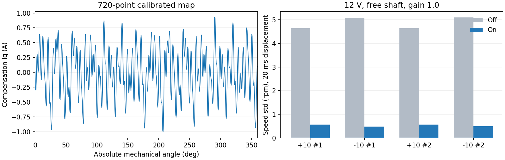

# 抗齿槽转矩补偿

适用于当前 M1 / TLE5012B / 龙邱 L4225-6S420-A、12 V 空载组合。磁编和 SPI 接线不变。补偿是 `Iq` 前馈，不是重新整定电流环，也不替代测速噪声或编码器误差的处理。

## 方案

参考 [ODrive 公开 controller.cpp](https://github.com/odriverobotics/ODrive/blob/master/Firmware/MotorControl/controller.cpp) 的逐位置静态采集思想。该公开版本记录驻留时速度积分器的转矩；本工程记录驻留的平均实际 `Iq`，并检查参考与反馈均值是否一致。增加反向第二遍，将双向数据按**实际停留角度**插值至同一网格再平均，以减小摩擦偏置，最后去掉整圈均值。

不要混淆版本：[ODrive 最新文档](https://docs.odriverobotics.com/v/latest/guides/anticogging.html) 描述的是逐渐减速的双向迭代采集。本工程目前实现静态驻留法。

* 整圈 720 点、间隔 0.5°，运行时循环线性插值，包括 359.5°→0°。
* 索引直接取瞬时机械绝对角度，不使用累计多圈角度求余，不受相对位置 `zero` 影响。`Iq` 表中已包含相序方向，不再乘一次方向。
* 前馈加在速度/位置 PI 输出之后、原电流限幅及抗饱和之前。直接 `Iq`、磁编校准、R/L 辨识和停机不施加补偿。
* 表峰值不超过 ±1.5 A，新表默认增益 0.5，当前电机验收后保存的增益为 1.0；按目标、参考、反馈三种转速绝对值中的最大值，30 rpm 以下全量、30～120 rpm 线性退出。启用/重新运行时 50 ms 渐入，正常补偿波形直接前馈，`stop` 立即清除当前输出。
* 不完整上传不能提交；重校准磁编使表失效。表绑定安装身份、极对数、方向和电角零点。
* Flash sector 11 的原 24 字节校准记录和 +64 电流参数记录保持 ABI，新增表位于 +128，版本/身份/校准绑定和校验码独立验证，magic 最后写。`tune save` 保存当前有效表；磁编 `cal` 保存新的校准时丢弃旧表。**启动恢复表时保持关闭**，确认当前安装一致后用 `cog on` 开启。

## 采集与验收

先在 VOFA 中断开 COM8。以下工具专用于 **12 V 空载轴**，每次结束都会停止输出、关闭补偿并恢复总览 `send 6`。

```powershell
# 工程根目录，双向学习→上传→同工况低速对比→通过才保存
python variants/m1-mt6835/tools/bench/anticogging.py --learn --compare --save --map build/longqiu/anticogging/map.json

# 同一磁编/磁铁/相线安装，加载已有主机表后重新验收
python variants/m1-mt6835/tools/bench/anticogging.py --load --compare --save --gain 0.50 --map build/longqiu/anticogging/map.json
```

当前这台电机已实测验收增益 `1.00`，复用本次原始主机表时可将第二条命令的增益改为 `--gain 1.00`；新安装仍从默认增益开始验收。

采集使用 10 kHz 专用静态位置 PID（1.2 A/°、1 A/(°·s)、0.020 A/rpm，测速滤波 0.5 ms），用于保持采样点，减少轻转子高刚度驻留的采样延迟。正常速度/位置运动仍使用原来的 1 kHz 串级控制和参数。该模式输出硬限 ±2 A，实际电流矢量超过 3 A、转速超过 100 rpm、母线超出电机范围或硬件时序异常时停止；无论 WARN/TRIP，目标超过 200 ms 未刷新也停止。每点超过 3 秒不满足驻留条件就结束，不填补失败点。

每点至少采 200 ms，角度均值距目标 <0.10°、标准差 <0.07°、峰峰值 <0.35°、前后 40 ms 均值漂移 <0.035°；实际 `Iq` 标准差 <0.15 A、参考和反馈均值差 <0.06 A。当前误差阈值是该编码器和自由轴下的采集约束，不代表零抖动。

正反整圈各 720 点，间隙不得超过 0.75°；去偏后的双向相关性至少 0.65，差值 RMS 不超过 `max(0.08 A, 表 RMS×0.8)`，表 RMS 至少 0.015 A。失败时保留 `.partial.json` / `.failed.npy` 供分析，不上传和保存。

验收做两组 +10/−10 rpm 配对开关试验，每段默认 14 秒，跳过首秒，速度由磁编位置的 20 ms 差分计算；每对补偿后的速度误差 RMS 至少降低 15%，且平均速度距目标不超过 1 rpm，全部满足才允许 `--save`。原始总览数据保存为 `.npy`，结果保存为 `.comparison.json`。窗口平均和位置差分指标不能代表所有频率的转速纹波，需要保留原始数据。

## VOFA 命令

```text
cog on         # 仅有效、完整、安装匹配的表可开启
cog off
stop
cog gain 0.50  # 停机且补偿关闭时，0..1，至多两位小数
cog save       # 停机，将表连同当前已启用的电流环参数保存
send 6         # 原单电机总览，帧及通道不变
send 9         # 抗齿槽状态，12 float 的旧组格式
```

`cog save` 是底层手动命令，不执行主机 A/B 验收。自动流程使用带 `--compare --save` 的工具。掉电、磁铁移动、相线互换、更换电机后，应重新验证或重新采集，不能将同一型号等同于同一安装。

`send 9` 的两个头字及 JustFloat 终止符沿用旧协议，十个载荷为：flags、已上传点数、绝对机械角度、当前补偿 Iq、增益、表峰值、校准零点、方向、极对数、安装身份。flags 位 0=有效、1=开启、2=上传中、3=采集中。`cog begin` / `cog point N A` / `cog commit` 是工具使用的有序停机上传协议；`stop` 取消尚未提交的上传。

## 回归

`test_anticogging.c` 用受周期转矩扰动的机械模型验证正负相序、零点重定义、跨圈插值、模式排除、限幅、无效表、校验和采集失联；该模型不能代替实机验收。`test_anticogging.py` 验证实际角度重采样、双向摩擦去偏及不完整/不一致/超限拒绝。编译链接 `control.c` / `foc.c` 时需加入 `App/Control/anticogging.c`。

## 多圈精度修复

旧代码把编码器小步进持续加到多圈 `float`。TLE5012B 每码为 `360/32768` 度，累计值超过 4096° 后不能完整表示单码步进。独立测试先转 12 圈，再走 4096 个单码：旧实现绝对角度漂移 −1°，理论 18.310547 rpm 显示为 17.903646 rpm。这会错索引补偿表，使短测通过的表在长时间运行后失效。

现改为圈数加瞬时角度重建多圈位置，外环位置由原点差计算，补偿用瞬时角度。相同测试角度误差为零，平均速度为 18.310547 rpm；实机连续约 18 圈后，双向低速重复对比再次通过。`test_position_precision.c` 是本问题的回归。早期累计角度版本的满量试验失败结果不用于评判最终补偿增益。

## 2026-10-10 实机结果

最终固件在 M1、12 V、空载轴上完成两轮正反低速开关对比，增益为 `1.00`。每段 8 秒、跳过首秒，以下为 20 ms 位置差分速度的标准差，不是瞬时速度的全部频率纹波。

| 目标 | 关闭补偿 | 开启补偿 | 标准差降低 |
| --- | --- | --- | --- |
| +10 rpm，第一轮 | 4.636 rpm | 0.569 rpm | 87.7% |
| −10 rpm，第一轮 | 5.077 rpm | 0.482 rpm | 90.5% |
| +10 rpm，第二轮 | 4.641 rpm | 0.572 rpm | 87.7% |
| −10 rpm，第二轮 | 5.099 rpm | 0.490 rpm | 90.4% |

开启后的平均速度距目标小于 0.01 rpm。保存后执行 MCU 复位，恢复表后再开启测试，+10/−10 rpm 的标准差分别为 0.587/0.510 rpm，平均速度为 9.998/−10.002 rpm。Flash 的角度校准、电流参数和补偿表三段校验均通过，原 R/L 和电流环增益保持一致，补偿表有效但启动默认关闭。

双向静态学习的相关性为 0.9913，差值 RMS 为 0.0539 A；最终表峰值为 1.0101 A。高转速退出补偿后，+300→−300 / −300→+300 rpm 的 90% 响应时间为 47.6/48.0 ms，与关闭补偿时的 48.0/48.0 ms 接近。最终低速数据无丢序、故障、警告和拒收；最终速度及位置动态测试也无故障或警告。试验结束保持停机并恢复 `send 6`。



[验收数据、实际 Flash 补偿表、固件 SHA256 与重启结果](data/anticogging-longqiu-20261010.json)。原始主机表和各段 `.npy` 留在本机 `build/longqiu/anticogging-20261010/`，该目录按现有规则不入 Git；可提交的记录已放入 `docs/data/`。
