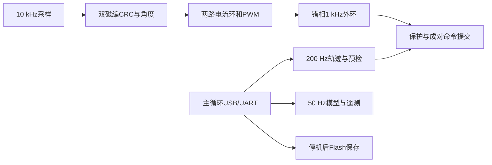

# 当前 FOC 架构

共用源码位于 `variants/m1-mt6835/`。当前轮腿使用 `Debug-dual-leg`；`Debug/Release` 为保留的单电机M1兼容构建，配置默认值集中于 `cmake/foc-defaults.cmake`。

| 模块 | 文件 | 职责 |
|---|---|---|
| 双路硬件 | `dual/hardware.c` | TIM1/TIM8、ADC、SPI1/SPI3、门极、采样时序 |
| 双路应用 | `dual/app.c` | 成对命令、预检提交、主机超时、遥测和停机快照 |
| 关节坐标 | `dual/leg_guard.c`、`leg_reference_config.h` | 7∶1圈数、近零恢复、行程/速度与限流 |
| 五连杆 | `dual/fivebar.c`、`fivebar_motion.c`、`fivebar_point.c` | 正逆解、雅可比、C²轨迹和动态约束 |
| 保存 | `dual/record.c`、`foot_record.h` | 两路电气与几何标定、共享Flash兼容和校验 |
| 共用电流环 | `App/FOC/foc.c` | Clarke/Park、Id/Iq PI、SVPWM、校准与保护 |
| 共用外环 | `App/Control/control.c` | 1 kHz反馈、轨迹速度前馈、重力积分、连续阻尼 |
| 单电机维护 | `App/Control/app.c`、`sensor_cal.c`、`motor_ident.c`、`anticogging.c` | 单路命令、扫描、R/L整定、抗齿槽 |

`dual/foc0.c`、`foc1.c`等薄封装通过 `alias0.h/alias1.h` 实例化共用状态机，避免复制两套算法。双路编译排除不可调用的裸轴抗齿槽采集，不再实例化两份表和采集状态；单电机的抗齿槽功能保留。

轨迹与遥测使用非活动缓冲构建，提交仅切换索引和少量状态。中断锁恢复调用前PRIMASK；长几何计算不在锁内。清理版移除临时阶段计时和临界区定位统计，保留中断总耗时、ADC/PWM故障原因以及 `send 7` 停机快照。

控制参数集中在 `dual/leg_config.h`，保护与减速比在 `leg_guard.h`。保持FOC10 kHz、外环1 kHz、轨迹200 Hz、遥测50 Hz、10 A指令和180 RPM保护。绝对电流比例、减速器齿隙、真实杆件位置和任意横向碰撞约束仍需实物验证。

Flash ABI、校验和身份绑定未改变。双路记录兼容单路历史区域；禁止通过删除旧结构定义来压缩保存格式。最新实测仍对应清理前已验证固件，见[报告](fast-reversal-fix-20261016.md)；清理后的构建只做离线回归，不自动烧录或启动机构。

## 清理验证

删除115个过时文档、数据、旧界面/运动脚本和重复生成包，约7.01 MB；保留原始机械边界、当前几何、最新通过数据和本机配置备份。VOFA生成物统一忽略，不再复制控件源码入库。

ARM双路构建通过，45项C配置、7套Python及VOFA离线交互回归通过。双路RAM从52704降至45336字节（减少7368），Flash从135188降至131420字节（减少3768）；CCM链接区域仍为固定64 KB，不以该保留区域大小推断运行时负载。控制参数、几何默认值、机械基准和Flash实现文件哈希未变。临时计时移除后的实际中断耗时尚未重新上板测量。
