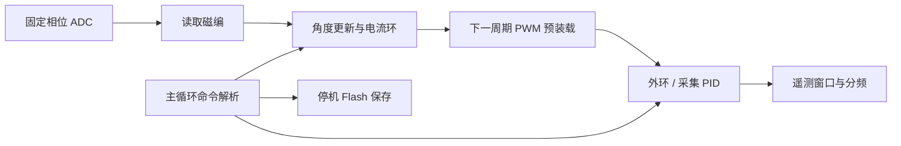

# 当前 FOC 架构

唯一固件源码在 `variants/m1-mt6835/`，目录名保留来源历史。当前默认 **M1 / TLE5012B / 龙邱 L4225-6S420-A / FREE_SHAFT / 安装 4 / WARN**；默认值集中于 `cmake/foc-defaults.cmake`，顶层和独立构建共用工具链实现。

## 配置与模块

`FOC_PORT` 选择功率接口及 PWM/ADC 路径；`FOC_ENCODER` 选择磁编协议；`FOC_MOTOR` 和 `FOC_LOAD_PROFILE` 选择电机/负载参数；`FOC_INSTALLATION_ID` 标记磁铁、编码器与相线的装配实例。M0/M1 只是功率接口。

| 模块 | 主要文件 | 职责 |
| --- | --- | --- |
| 硬件接口 | `foc_port.h`、`bsp_motor.c`、`bsp_adc*.c` | PWM/ADC、周期统计、采样窗口、功率关断 |
| 磁编 | `foc_encoder_profile.h`、`bsp_encoder_*.c`、`spi.c` | TLE5012B/MT6835 协议和有效角度 |
| 电机配置 | `foc_motor.h`、`foc_profile.h` | 型号/负载参数、组合限值、Flash 身份 |
| 电流环 | `foc.c` | 角度与电流变换、PI、Ld/Lq 前馈、SVPWM、状态机 |
| 外环 | `control.c` | 速度 PI、位置轨迹、目标保持和采集 PID |
| 自动适配 | `sensor_cal.c`、`motor_ident.c` | 极对数/零点/方向、R/L 辨识和候选验证 |
| 抗齿槽 | `anticogging.c` | 720 点 Iq 前馈、安装绑定和速度退出 |
| 应用 | `app.c`、`telemetry.h` | 命令事务、遥测、告警和保存调度 |

M0 为 TIM1/10 kHz，ADC1 顺序采样或可选双 ADC；M1/TLE5012B 为 TIM8/双 ADC DMA/10 kHz，M1/MT6835 为 20 kHz。TLE5012B 同步 SPI 完成后进入采样函数，MT6835 由 SPI DMA 完成回调进入。普通外环 1 kHz，抗齿槽静态学习按采样频率执行。频率选择以 `foc_port.h` 为准。

## 调度与保存

角度由整数圈数加瞬时机械角重建，外环位置通过原点差计算，抗齿槽表直接索引瞬时角度。电流参数保持 SI 单位，离散 PI 系数在参数事务时缓存。主循环修改运行状态和参数使用短中断临界区；Flash 擦写前关闭功率输出并暂停采集，恢复后不把暂停时间当作一个控制周期。

Flash sector 11：角度校准记录在 +0，电流参数在 +64，抗齿槽表在 +128。校准支持现行 v4 与兼容的 v3；参数和补偿分别检查版本、安装身份、角度绑定及校验码。上电只做静止电流零偏估计，不自动旋转；有效表恢复后保持关闭。具体命令与 ABI 见[自动适配](motor-autotune.md)和[抗齿槽](anticogging.md)。

USB `send 6` 是 24 float 的单电机总览；其余兼容组有两个头字和十个载荷，`send 7/8/9` 分别用于 R/L、磁编扫描、抗齿槽。UART 共用命令解析，CAN 当前只有底层收发队列，没有电机控制协议。

构建和主机回归能验证算法及配置组合，ADC/SPI 最坏时序、绝对电流比例与机械负载表现仍需对应实物测量。历史文档按当时的固件与安装解释；本次整理范围和优化顺序见[清理记录](code-cleanup-2026-10-10.md)。
