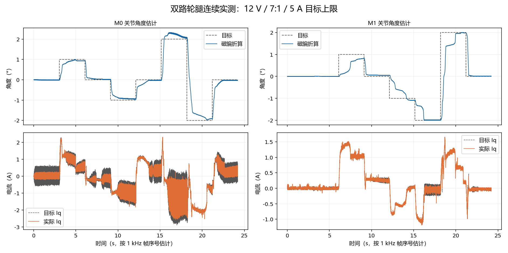

# 双路轮腿电机控制（2026-10-13～14）

本次已在架起、支撑的轮腿机构上烧录并跑通两路 L4225-6S420-A：各自电角度/方向校准、双路位置保持、单轴动作时另一轴保持、±2°关节联动和反向、失联关断、校准记录重启加载。正常测试用每路 5 A 上限；允许设置到 9 A，按当前采样标定测得的相电流或电流矢量达到 9.5 A 时关断两路。

## 接线和单位

| 通道 | 磁编接口 | SPI 引脚 | CS | 电机口 |
|---|---|---|---|---|
| M0 | SPI1（沿用双路分支接线，原口述 SPI0） | PB3/PB4/PB5 | PA1 | M0 |
| M1 | SPI3 | PC10/PC11/PC12 | PA0 | M1 |

两个磁编均为 TLE5012B，安装在电机轴；减速比 7:1。14 极电机使用 7 极对，减速比不会改变极对数。软件累计电机轴多圈角度再除以 7，作为关节转角估计；齿隙和输出杆形变无法由电机轴磁编测出。命令和总览的位置为**关节度**，速度为**关节 rpm**；内部控制器和校准仍使用电机轴度/rpm。

上电姿态为本次运动窗口的参考，目标范围 ±2.5°、实际越界关断范围 ±3.8°。`m0/m1 zero` 仅修改软件坐标，不扩大运动窗口；`stop`、`clear`、校准也不重置窗口。当前没有关节绝对零位、完整 90°机械行程或并联腿死点标定，不通过反复重启扩展行程。重启后参考姿态会重新建立，需先确认姿态和支撑。停机和故障会切断两路输出，实测机构会被动移动，仍需支撑腿部。

## 构建

在本仓库的 `STM32F405-FOC/` CMake 工程目录运行：

```powershell
cmake --preset Debug-dual-leg
cmake --build --preset Debug-dual-leg
```

固件：`build/dual-leg/Debug/STM32F405-FOC.elf`。该预设显式选择双路、龙邱、TLE5012B、TRIP、安装基号 5、10 kHz 电流采样和 1 kHz 总览。原 `Debug` 单路入口保留；当前车模使用双路预设。

两路复用现行 `App/` FOC/控制算法，通过别名分别编译出独立状态；同步 PWM、双 ADC 及两组 SPI 采集参考 `双路FOC控制` 分支。提前 ADC 触发点到 4000 tick，为两路计算预留时间；两路任一传感器、PWM 时序、电流或行程故障都关断两路。SPI 校验检查各磁编实际响应编号，而不是假定两颗器件响应编号相同。

## 校准和控制

COM8，1000000，8N1，DTR，ASCII 命令以 CR/LF 结束。USB 遥测为 JustFloat。上电只估计静止电流零偏并加载校准，不自动通电。

两路本次校准已保存，接线/磁铁安装不变时无需再次校准。新安装需架起并持续支撑机构，再依次执行：

```text
stop
m0 cal 7.50
m1 cal 7.50
```

每路约 12 秒，须确认前一路已结束且通过后再开始下一路。校准以 2 秒斜坡建立电流，磁场按 0 → +60° → 0 → −60° → 0（M1 基角为 90°电角度），各步缓慢过渡。±60°电角度对应 ±8.57°电机轴、约 ±1.22°关节；初始对极可能移动更多，独立行程保护一直有效。

验收包括：正反跨度符合 7 极对、末段静止标准差小于 0.2°电机轴、回到基角的总回差不超过 7°电角度、两侧方向一致且跟随幅度近似对称。零位取正反两次回程位置中点，减小减速箱摩擦的方向偏差。失败不保存新结果，两路关断。此流程为**已知龙邱电机的有界带载角度校准**；当前车模不开放整圈极对扫描、R/L 自动辨识或整圈抗齿槽采集。电流 PI 使用此前龙邱测得的 R/L 初值与 200 Hz 带宽，本次没有重新辨识每个电机的 R/L。

双路记录为 v6，放在扇区 11 的 +4096 区域，区分 M0/M1、磁编、电机和安装号 5/6。修改安装时递增基号，允许 1～14（第二路使用基号+1）。保存双路记录时保留旧单路前 4 KB，实测逐字节一致；旧单路固件重新校准会擦除该扇区，切换并重校准前应备份。

```text
send 0
limit 5
leg pos 0 0
leg pos 2 -2
leg pos -2 2
stop
```

`leg pos` 原子接受两路目标；一侧不合法时两侧均不修改。位置命令须持续刷新，推荐每 40～50 ms 一次；200 ms 没有新目标，两路以故障 7 关断。单次命令不能永久保持。`m0 pos 1`、`m1 pos -1` 和 `m0/m1 hold` 也支持，但联动机构推荐始终刷新成对目标。

`limit 0.2`～`limit 9` 只在两路停机时生效，默认 5 A；它限制正常位置输出，不改变显式 `cal` 的电流目标。`stop` 或 `all stop` 关闭两路；`m0/m1 stop` 关闭指定路；故障后确认姿态再 `clear`，不会自动恢复驱动。当前仅开放位置控制，连续 rpm、直接 Iq 和整圈扫描命令不接受。

位置控制采用限速轨迹 → 位置 P、速度阻尼、位置积分 → Iq，电流环保持独立。积分在位置误差过零时减半，避免克服静摩擦后继续推过目标。M0/M1 的电机轴位置刚度分别为 0.45/0.18 A/°，速度阻尼为 0.07/0.03 A/rpm，位置积分为 0.35/0.08 A/(°·s)，以适应实测不同的机构负载。

## VOFA

已生成并安装双路配置；旧配置备份在仓库 `exports/vofa-dual-leg/backup/`。启动 VOFA，选 COM8、JustFloat、DTR，使用“轮腿 M0 / M1 · 7:1”页面。点击“双路总览”后，先用 0/0 开始保持，再设置小角度。控制面板每 50 ms 刷新成对目标；角度输入限制 ±2°，电流输入最大 9 A，默认 5 A。关闭面板、遥测过期、切到诊断组或故障会停止刷新并请求停机；固件还保留独立的 200 ms 失联保护。

配置源和通道表：[生成器](vofa/configure_dual_leg.py)、[通道定义](vofa-dual-leg.channels.json)。重新生成/安装前退出 VOFA：

```powershell
python docs/vofa/configure_dual_leg.py
python docs/vofa/configure_dual_leg.py --install
```

Qt 模拟验证已覆盖 QML 加载、无新数据启动拒绝、50 ms 持续发送和诊断切组停机；未用桌面鼠标进行本次界面验收。原单路 VOFA 的同为 24 通道总览含义不同，不能混用旧标签。

## 实测结果

以下为磁编折算关节角度，在架空支撑、12 V 条件下的末 200 帧均值误差，不等于输出杆的机械测量精度。

| 连续目标 M0/M1 | M0 误差 | M1 误差 | M0/M1 峰值 Iq |
|---|---:|---:|---:|
| +1° / 0° | -0.066° | -0.001° | 2.26 / 0.17 A |
| 0° / +1° | +0.016° | -0.184° | 0.88 / 1.52 A |
| −1° / 0° | +0.055° | +0.047° | 1.83 / 1.12 A |
| 0° / −1° | -0.021° | -0.085° | 1.58 / 0.87 A |
| +2° / −2° | +0.070° | +0.010° | 2.57 / 1.19 A |
| −2° / +2° | +0.090° | -0.021° | 2.52 / 1.65 A |
| 返回 0° / 0° | -0.025° | +0.012° | 1.28 / 0.99 A |

两路 7.5 A 校准均通过；正常 2 A 上限时 M0 曾无法克服阻力，最终正常上限取 5 A，不需要默认使用 9 A。提高空载速度 PI 增益曾引起起步振荡，已替换为当前位置电流控制；最终连续测试没有故障，末段波动标准差最大约 0.019°。命令刷新停止后 PC 约 0.229 s 观察到两路失联关断（包含 USB/主机观察延迟，固件门槛为 200 ms）。重启加载两路校准成功，故障清除保留校准和运动窗口，最终两路输出关闭。



结构化结果：[实测摘要](data/dual-leg-20261014.json)。本机完整采样和 Flash 备份在 `build/dual-leg/`，包括 `final-image-sequence/`、`final-watchdog/`、`flash-before.bin`、`flash-after.bin`。

## 主机和台架工具

```powershell
python variants/m1-mt6835/tests/run_tests.py --cc C:/mingw64/bin/gcc.exe
python variants/m1-mt6835/tools/bench/dual_leg.py --out build/dual-leg/preflight
python variants/m1-mt6835/tools/bench/dual_leg.py --sequence --seconds 3 --limit 5 --out build/dual-leg/retest
python variants/m1-mt6835/tools/bench/dual_leg.py --watchdog --out build/dual-leg/watchdog-retest
```

运行台架工具前在 VOFA 断开 COM8；继续保持车模架空支撑。工具从停机开始，最后关闭两路并释放串口；连续序列含两路 ±2°和单轴 ±1°，到位误差要求 0.25°、末段标准差要求 0.1°。

最终完整回归通过：42 组 C 配置、5 组 Python 套件；单路/双路 ARM 构建均成功，正式镜像烧录校验及重启后的连续双路测试通过。
