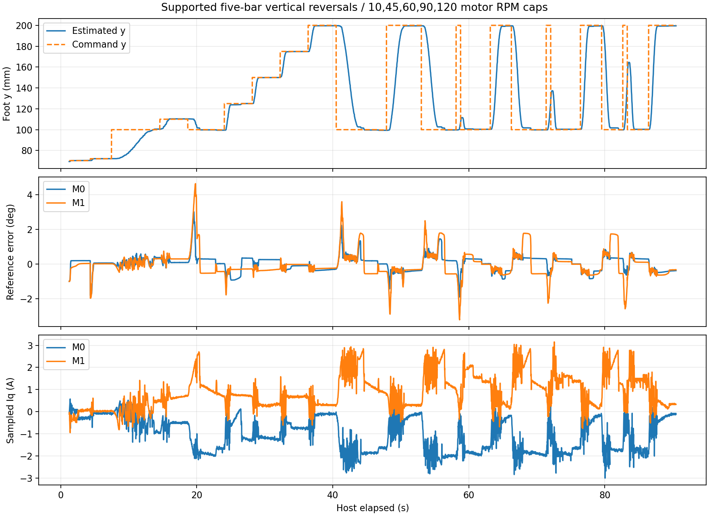

# 足端快速反向调试（2026-10-16）

连续阻尼新版已烧录，并通过x=0、y=100↔200 mm的10、45、60、90、120电机RPM分级实测，包括运动中反向；全程无故障，用户确认没有明显高频振动或噪声。

针对此前足端快速档、x=0、y=100↔200 mm 上下换向停机。串口现场确认锁存故障11（超速），短读复核ADC reason/gap均为0；不能把该次故障归因为ADC负载。用户另确认每次停机前有高频振动，属于仍需实物验证的控制稳定性问题。

## 当前改动

- 位置误差产生的额外追赶速度限制为30电机RPM，防止大偏差直接形成大电流冲击。
- 附加制动改为连续阻尼：超过 min(|轨迹速度|,配置速度上限)+20 RPM 后，每超出1 RPM追加0.02 A反向阻尼。旧版在阈值处强制总电流换向，会丢失负载支撑电流并产生跳变；新版保留重力积分，附加阻尼从零连续增加。
- 阻尼、测速滤波与电流变化率按平滑轨迹速度渐变，取消按实测速度切换“移动／静止”的硬切换，也取消制动触发时突增的800 A/s变化率。电流变化率为120～240 A/s，测速滤波为5～2 ms。
- 积分有电压/电流抗饱和；额外制动期间只允许积分增加制动力，避免积累加速方向的偏置。积分最大3 A。
- 独立超速估计改为1 ms净位移、约5 ms均方值包络。原100 µs原始差分先平方会放大磁编噪声。FOC自己的速度保护、每个样本的CRC/间隔/跳变检查仍保留。

电流指令上限10 A、硬过流11 A、180 RPM超速停机、关节0°～110°、ADC/PWM保护均未放宽。FOC仍10 kHz、外环1 kHz、前台轨迹200 Hz、遥测50 Hz；未增加正常路径诊断发送。

英飞凌[TLE5012B数据手册](https://www.infineon.com/assets/row/public/documents/24/49/infineon-tle5012b-exxxx-datasheet-en.pdf)表12给出典型角度RMS噪声0.04～0.08°。独立噪声直接做100 µs差分时，sigma=0.08°对应速度RMS约189 RPM。这说明原估计器有噪声敏感性，但不能证明实物每次故障均由噪声造成；更新测速后仍曾观察到短促振荡和超速。

## 显示与诊断

初始化失败时USB继续提供诊断，面板指出对应磁编无有效应答；禁止启动。已恢复角度但超出驱动范围时，仍显示关节角和姿态，并说明按钮不可用原因。恢复位置不改变保存零位。

`send 7`读取首次停机快照，stop不覆盖。第18/19通道为两路独立速度RMS；若单轴已经先跳闸，其参考可能已被清除，快照不能作为完整预触发记录。测试工具停机后另读group2，两路硬件门极模式均为0才确认输出关闭，避免将FAULT状态误判为未关断。

## 构建与离线验证

当前ELF SHA256：`88d5fa513a6fba743a849e04ef1a248f0defaac1e96189654167db24b706445b`，已烧录校验。

45个C配置和7套Python均通过。新增回归覆盖四种机械/电气方向的连续阻尼阈值、静止±0.08°交替噪声不误报、真实正反220 RPM在20 ms以内跳闸。双路真实FOC模型在建立2.5 A等效重力补偿后完成三次y100↔200往返；这不代表陌生负载一开始就能达到该精度，也不能代替实物验收。

## 实物记录与限制

中间版本曾完成60 RPM完整往返及途中反向，但90 RPM返回时超速。更改速度估计后仍在60 RPM返回时超速；加入追赶限速但保留不连续强制制动的版本，在10 RPM小回程也发生超速，用户确认停机前高频振动。因此这些中间版本均不作为快速控制合格版本。

原始串口故障见[data/fast-fault-serial-20261016.json](data/fast-fault-serial-20261016.json)。中间故障过程已合并为上段说明，只保留当前几何、最终通过数据与曲线。大块运行中SWD读回曾出现散落字错误，未作为验收依据。

最新连续阻尼版本实测通过，共4553帧（50 Hz）记录，停止后两路硬件门极模式均为0。

| 项目 | 实测结果 |
|---|---|
| 小幅/低速 | 1°、3°及10 RPM足端100→110→100通过 |
| 分级快速 | 45 RPM逐级到200及返回；60/90/120 RPM完整100↔200及途中反向均通过 |
| 120 RPM档100→200 | 两轴进入±1°并保持：约1.32 s |
| 120 RPM档200→100 | 两轴进入±1°并保持：约2.57 s |
| 全程稳态关节误差 | 最大约0.584°；末0.5秒标准差最大0.093° |
| 推算足端稳态误差 | 最大约0.663 mm，来自电机磁编与几何模型 |
| 50 Hz采样Iq | M0约3.01 A、M1约3.15 A；不是10 kHz真实峰值 |
| ADC/时序 | ADC故障原因0、间隔异常0；采样中断最大16039周期，约95.47 µs |
| 保存标定 | 144字节与烧录前逐字节一致 |
| 用户观察 | 无明显高频振动或噪声 |

到位时间从主机发命令开始计算，包含确认、规划与传输，时间分辨率约20 ms。不同速度档的保持时间包含到位后等待，不能当作运动时间。重力反向的到位仍慢于顺向，没有实现任意目标瞬时到位；中断余量约4.5 µs，后续增加功能应优先保留FOC时序。

[分段数据](data/vertical-fast-response-20261016.json)与实测曲线：

结束释放输出后M0约114.26°、M1约107.97°，无故障且圈数跟踪有效。重新操作前支撑并将两轴移入0°～110°，建议2°～108°；同一次通电不需要重新恢复零位。

当前几何见[data/fivebar-current-geometry-20261016.json](data/fivebar-current-geometry-20261016.json)：x=0时两轴目标约相差7.81°，不能套用旧的两轴等角监督。足端位置来自电机磁编与几何推算，没有独立足端测量，也未覆盖其他横向路径。

## 源码清理说明

后续清理移除了双路不可调用的裸轴抗齿槽采集和临时细分计时；保留控制参数、位置恢复、Flash ABI及全部保护。以上实测对应本报告SHA的已验证固件；清理构建仅做离线回归，没有重新烧录或驱动机构。
