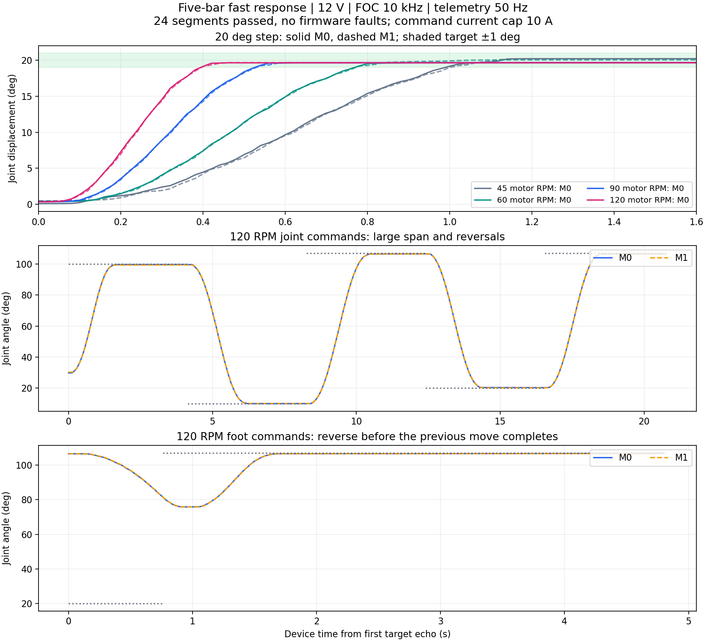

# 五连杆快速响应实测 · 2026-10-15

最终固件已烧录并校验，关节和足端两种接口共24段测试通过，覆盖10/45/60/90/120电机RPM、100°→10°→107°、107°↔20°及运动中换向。4202帧遥测无故障，结束确认两路IDLE、输出关闭。用户反馈“没有明显异常”。

20°切换从原约1.0～1.1秒缩短为约0.40～0.42秒进入并持续保持±1°；87°大跨度约1.86～1.90秒，原45RPM版本约5.1秒。响应速度约提高2.5～2.7倍。时间基于板端10kHz采样计数，从首次目标回显开始，遥测分辨率约20ms；不含主机传输及确认前规划，不能视为鼠标点击到运动结束的精确时间。

## 改动与FOC优先级

- 已标定的双路 `leg pos` 与 `foot pos` 共用带完整路径预检、平滑制动再换向的五次关节轨迹，支持运动中更新；关节命令立即回显最终输入角度。未标定及单轴旧轨迹限制45RPM。
- 电机速度上限扩展至120RPM；60/90/120档的电机加速度分别300/600/900RPM/s，规划另留速度/加速度裕量。足端速度配置2～400mm/s、加速度上限1800mm/s²，实际由足端和关节约束共同决定。
- 10kHz电流环、1kHz外环、200Hz关节参考保持。正解/雅可比显示检查与USB遥测降为50Hz，避免高频重复几何计算占用前台。电流PI及其带宽未修改。
- 预检期间每32个路径点服务旧参考和遥测，维持已接受动作；不递归处理命令、不刷新主机看门狗。候选计划在中断开放时复制到非活动缓冲，提交只切换索引；停止或故障变更版本号后不能提交旧计划。
- 电流指令上限10A、硬相/矢量过流11A、180电机RPM超速、ADC间隔16000～17600CPU周期、PWM截止、500ms主机看门狗和关节边界保持原值。

本轮中间版本曾在旧高速关节路径触发超速，随后改用公共规划器；另一轮在45RPM时发生17636周期采样间隔故障，保留现场后移出关中断区的大块轨迹复制并缩短热路径。最终版本重新从小幅验证开始，全部24段通过；没有通过放宽ADC或超速保护取得最终结果。

## 最终实测

| 项目 | 结果 |
|---|---:|
| 45RPM，30°→50° / 50°→30°，持续±1° | 1.00 / 1.10s |
| 60RPM，同上 | 0.78 / 0.80s |
| 90RPM，同上 | 0.54 / 0.52s |
| 120RPM，同上 | 0.40 / 0.42s |
| 120RPM，关节107°→20° / 20°→107° | 1.86 / 1.90s |
| 120RPM，足端对应相同关节端点 | 1.86 / 1.90s |
| 120RPM，关节100°→10° / 10°→107° | 1.94 / 2.14s |
| 120RPM，运动中反向后回到原目标 | 约0.88s |
| 最后0.5秒反馈关节误差最大值 | 0.612° |
| 最后0.5秒反馈波动标准差最大值 | 0.048° |
| 遥测Iq峰值 M0 / M1 | 4.015 / 3.837A |
| 观测到的ADC中断峰值 | 89.048µs，周期100µs |
| 运行中关中断区测量峰值 | 4.202µs，位置为最后stop；未含少量进入/退出指令 |
| 新目标规划峰值 | 49ms，提交上限100ms |
| 最终ADC原因 / 全局故障 | 0 / 0 |

稳定性统计取各档保持3～5秒的最后0.5秒；0.40秒是进入±1°的运动指标，不表示全部静态残差在0.40秒内消失。最终轮次无需额外延长任何一档保持时间。电流为现有ADC标度的遥测值，未使用外部电流仪器独立标定。

条件仍为12V、架起并可支撑机构、7∶1减速箱、两路同步路径。实际测试2.5°～107°，驱动命令边界仍0°～110°，足端端点留2°～108°。仅验证同步路径，任意横向足端路径的机械净空仍需另测。关节/足端反馈来自电机轴磁编，未独立测量输出轴和足端物理位置；齿隙、杆件柔性和几何误差仍影响实际精度。

## 使用

重新打开VOFA，面板默认**快速120电机RPM**，正常60、慢速10；足端对应400/200/20mm/s，启动电流上限默认10A。连接COM8，确认已有回零与几何标定有效，输入关节角或足端x/y，点“移动到目标”；运动中修改再点“更新目标”。面板每50ms维持命令，到位持续保持；不会因重连、布局恢复或清除故障自动启动。

同次上电跟踪有效时，从当前合法姿态即可启动，不必重复回零。若普通回零提示止点不匹配，操作者确认两路贴紧**原可靠上止点**后，维护工具可用 `leg home confirmed` 采集本次零位；仍拒绝输出开启、运动或陈旧采样。该入口只用于明确的人工物理止点确认，不能解决单圈磁编冷启动圈数不唯一的问题，也不能在任意姿态使用。本轮因人工确认原止点而采集，保存的两路电角度/几何记录144字节与测试前完全一致。

## 复核文件

- 数据摘要：[JSON](data/fivebar-fast-response-20261015.json)，原始24段记录与CSV位于 `build/dual-leg/wheel-leg-ui/native-unified-timing-20261015.*`。
- 最终固件：`build/dual-leg/wheel-leg-ui/fivebar-fast-20261015.elf/.bin/.hex`；SHA256：`48613aa5add9ee5ce2a244b3e2f7fd6f58011ca4b6d3aa66d121dce0d7dc8e29`（ELF）。
- 只读现场：`fast-final-stages-20261015.bin`、`fast-final-timing-20261015.bin`、`fast-final-calibration-20261015.bin`，位于同一目录；快照地址与最终符号表核对。
- 完整离线回归：45个C配置、7个Python套件；日志 `build/dual-leg/wheel-leg-ui/fast-final-regression-20261015.log`。另有VOFA离屏交互/渲染QA，验证默认快速档、未标定限制、参数串行确认、途中更新、失联和故障停机。
- 操作说明：[轮腿面板](wheel-leg-quickstart.md)；规划与协议：[足端控制](fivebar-foot-control.md)。
