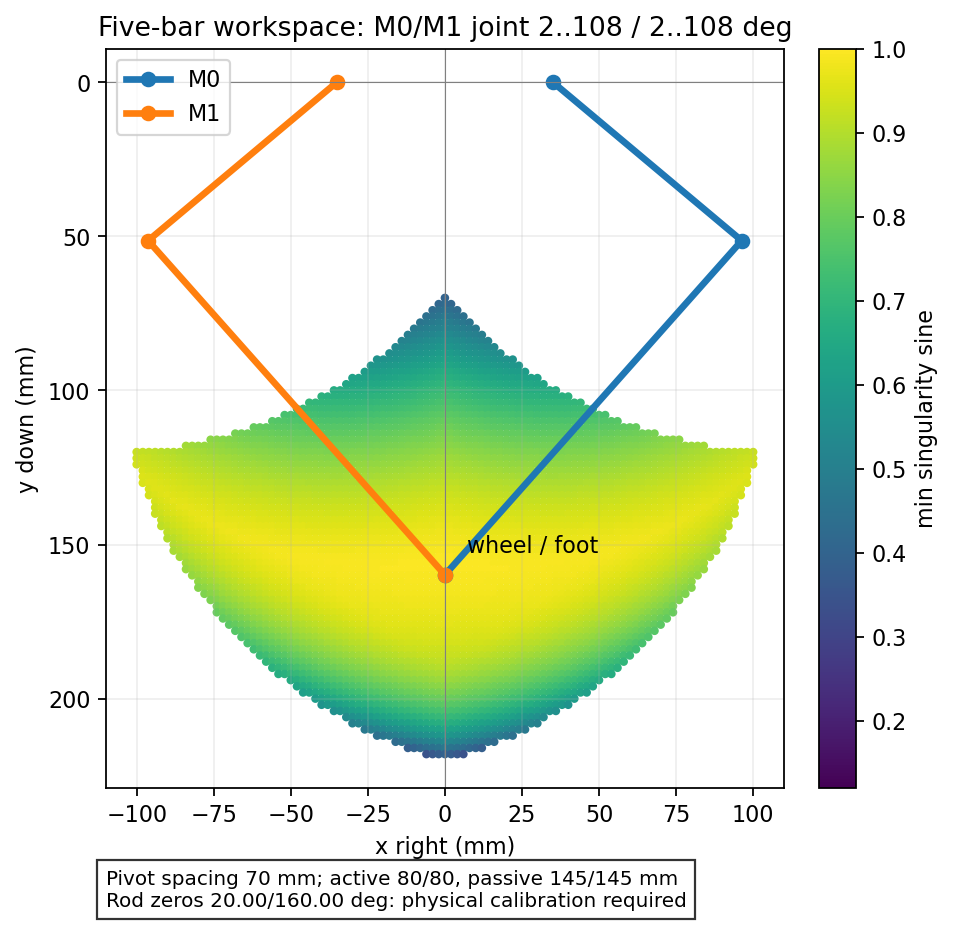

# 五连杆足端位置控制

日常操作优先使用[VOFA按钮面板](wheel-leg-quickstart.md)，无需手动发送命令循环。

已将足端正逆运动学、解析雅可比和关节空间定点轨迹接入 `Debug-dual-leg` 固件。接口 `foot pos x y` 以毫米输入轮轴目标，解算为 M0/M1 的逻辑关节角，再经已有 7∶1 换算交给两路位置闭环。轮轴就是两被动杆交点。

## 机构与坐标

从用户指定的正面观察，以两个固定轴中点为原点，x 向右、y 向下。该坐标系固定在车身上；若要地面坐标，需要再结合车身 IMU/位姿做坐标变换。

| 参数 | M0（右侧） | M1（左侧） |
|---|---:|---:|
| 固定轴坐标 mm | (35,0) | (−35,0) |
| 主动杆 mm | 80 | 80 |
| 被动杆 mm | 145 | 145 |
| 名义零位杆角 θ，水平向右为0°，逆时针为正 | 20° | 160° |
| 正逻辑关节角的几何转向 | 顺时针，θ=θ₀−q | 逆时针，θ=θ₀+q |
| 足端模式允许 q | 2°～108° | 2°～108° |

几何转向与 `leg_direction()` 的磁编计数方向是两回事：磁编 M0 正计数、M1 负计数；减速器内部转向和电角度仍由原驱动处理。主动杆角度使用关节角度，不能再乘7。

表中20°/160°为源码默认名义几何；当前板端已保存的零偏约24.75°/−196.94°，见[data/fivebar-current-geometry-20261016.json](data/fivebar-current-geometry-20261016.json)，实际解算优先读取板端。

新装配的20°/160°来自目测，默认 `FIVEBAR_ZERO_CALIBRATED=0`。此时可离线解算、查看模型，但足端和超过45电机RPM的关节驱动命令被拒绝；慢速 `leg pos` 功能可继续使用。



图中可达域使用名义零偏，仅检查杆长、关节限位和奇异点裕量；不代表已经验证所有异步关节组合与车架、轮子及其他杆件的碰撞。此前实物只验证了两轴同步路径。

## 解算方案

固定轴为 Aᵢ，主动杆末端为 Bᵢ，足端为 P。取 θᵢ 为逆时针角：

```
Bᵢ = Aᵢ + aᵢ (cosθᵢ, −sinθᵢ)
|P − Bᵢ|² = bᵢ²
```

正解求两个以 Bᵢ 为圆心、bᵢ 为半径的圆交点。两个交点对应不同装配模式，配置固定取当前足端在下方的模式。

逆解令 rᵢ=P−Aᵢ，ρᵢ=|rᵢ|，φᵢ=atan2(−rᵢy,rᵢx)：

```
θᵢ = φᵢ + elbow_signᵢ · acos((ρᵢ²+aᵢ²−bᵢ²)/(2aᵢρᵢ))
qᵢ = (θᵢ − zero_ccwᵢ) / q_signᵢ
```

根据物理区间恢复360°周期的正确角度，固定 M0/M1 肘部工作分支，随后再用正解核对足端位置。输入不可达、目标超出2°～108°、选择了另一装配分支或接近奇异点时，返回明确状态，不把非法目标截断成另一个坐标。

对杆长约束求导，Uᵢ=P−Bᵢ，得到 `A·P_dot = B·q_dot`。A的两行为Uᵢ，B为对角矩阵，其元素是 `Uᵢ·dBᵢ/dqᵢ`。代码同时给出 `J=A⁻¹B`（mm/关节度）和逆雅可比（关节度/mm）。分别检查主动/被动杆夹角和两被动杆夹角的正弦绝对值，默认都必须≥0.12，避免伸直、折叠或并联死点附近的速度放大。

多解、工作模式和两类奇异点的处理参考 [Chablat/Wenger 的原始论文](https://arxiv.org/html/0707.2006v1)；轮腿五连杆的建模组织参考 [RP_Balance 原作者的 Five_Link_Base](https://github.com/WilliamGwok/RP_Balance/blob/main/MatlabWorks/SJTU_Model/Model/Five_Link_Base.m)。本工程按当前坐标和机构独立编写几何C实现，未复制其控制代码。

## 轨迹与运行时行为

主循环每5 ms只计算预检通过的关节多项式参考及速度前馈，ADC中断消费成对目标，外环不再重复整形。正解/雅可比运行检查与显示计算降为50 Hz。几何已标定时，`leg pos Q0 Q1`也使用相同规划器，避免高速关节命令落回旧轨迹；未标定调试及单轴旧接口限制45电机RPM。所有正逆解、三角函数和路径预检均在中断之外。

目标足端先逆解到两个关节，在关节空间采用五次多项式；初次运动从静止当前姿态开始，终点速度/加速度为0。足端路径一般不是直线，因此同步关节的长距离动作不会被笛卡尔直线穿越机构不可达区所拒绝。运动中换目标从当前参考的位置、速度、加速度接续，保持C²连续。运动中更新目标时，先从当前参考的位置、速度、加速度平滑制动到静止，再衔接新目标，两段连接的速度和加速度都为0；静止后更新目标只需一段。这样避免对带初速度的单段曲线反复延长时间、反而扩大制动越界并耗尽规划预算。足端加速度包含雅可比变化项，不能仅使用J乘关节加速度。重复发送同一目标只刷新主机看门狗，不会重启曲线。`foot hold` 将当前估算足端作为新目标，运动中仍平滑制动，不能作为急停。

每次新目标先验证整个候选曲线的离散采样点，包括换向时可能超出端点的制动段。按端点跨度选择128/256/512段，必要时继续加密到512段，并要求相邻点≤1 mm、关节变化≤1°；无法达到分辨率则拒绝。终点仍限制2°～108°；整段曲线限制在物理0°～110°，允许直接从可靠回零边界向内出发。检查固定分支、限位、奇异裕量以及雅可比映射后的关节速度/加速度。它是带裕量的数值预检，不是连续区间的形式化证明，也不包含三维碰撞模型。

默认足端速度50 mm/s、加速度上限1800 mm/s²；关节规划速度留在 `leg rate` 上限的80%以内，关节加速度采用所选电机加速度的70%，必要时延长时间。`leg rate`接受10～120电机RPM；45及以下采用150 RPM/s，60/90/120档分别采用300/600/900 RPM/s。足端模式运行期间拒绝更改配置；关节规划完成且两轴低于5 RPM时可配置下一段。面板慢速/正常/快速足端档为20/200/400 mm/s，配对电机档为10/60/120 RPM；实际速度仍由足端和关节两套约束共同限制。10 A指令上限、11 A瞬态硬保护、180电机RPM超速、母线保护、关节边界保护和堵转保护沿用现有配置。

内部200 Hz目标更新不能续期主机500 ms看门狗；主机必须持续发送目标。失联关闭两路并锁存UART故障。停止、故障或新的合法 `leg pos`/`m0 pos`/`m1 pos` 会取消足端控制权；足端模式中单轴stop也同时关闭两路。规划过程中发生故障/停止，其版本号会阻止旧规划重新开启驱动。

## 一次性主动杆零偏标定

更容易测准的方法是使用水平尺/直角定位工装，把两根**主动杆**摆到一个已知角度，例如确实竖直向下时两根均为−90°。标定命令输入M0在前、M1在后。重力垂直只在两个固定轴连线已水平时等价于车身坐标的−90°。

1. 烧录后支撑机构，把两路放到原上止点向行程内0°～40°区域，发送 `leg restore` 恢复相对保存基准的连续关节角。不要把任意当前位置当作新零位。
2. 保持采样不断、两路输出关闭，手动移到可重复的已知主动杆姿态并固定。不要重新home；主动杆竖直姿态若超出软件2°～108°窗口，可以在输出关闭时标定。
3. 两杆确实竖直向下且已稳定时发送 `foot cal -90 -90`。该命令要求已home、配对角度新鲜、两路IDLE/关闭输出且转速低于5电机RPM。它只求 `zero_ccwᵢ=θ_knownᵢ−q_signᵢ*q_currentᵢ`，不会启动、不会重定义关节零位。
4. `send 4` 查看零偏和标定标志；随后手动恢复到合法且支撑的姿态，用 `send 3`/离线工具核对估算轮轴坐标与尺量值。两种姿态交叉检查有助于发现方向、杆长或安装错误。

`foot cal` 更新RAM零偏，再发送 `foot save` 保存到板上。VOFA的“标定并保存”按钮发送组合指令 `foot calibrate`，仅当已知竖直姿态标定成功后才保存，不再需要导出头文件和重新烧录。

保存只在输出关闭时允许，暂停采样并保留原电机/抗齿槽前缀和双路电角度记录。保存完成后恢复采样、两路继续关闭，同时使圈数基准失效；将机构移到原上止点向内0°～40°区域，再用 `leg restore` 恢复位置。后续启动直接加载几何记录，但仍须恢复关节圈数。更换安装后重新标定。

`fivebar_tool.py export` 和 `fivebar_calibration.h` 保留为离线备份/编译默认值的途径；正常使用无需操作它们。

当前磁编装在电机轴，360°单圈对应51.43°关节周期，冷启动无法唯一确定110°区间中的关节位置。该运动学模块不改变这个硬件事实。输出轴绝对编码器可解决免回零，并直接测到部分回差；若要毫米级物理足端精度，也应校验机械零偏、轴距、实际杆长、传动回差和受力形变。当前遥测是电机轴角度推算的足端，不能当成独立测量。

## 指令与工具

| 指令 | 功能 |
|---|---|
| `foot pos X Y` | 足端目标mm，两个数字最多2位小数，至少每500 ms刷新 |
| `foot hold` | 平滑到当前估算足端；随后仍需刷新目标 |
| `foot save` | 输出关闭时保存几何，完成后在近零区域恢复位置 |
| `foot stop` / `stop` | 立即关闭双路 |
| `foot speed 400` | 设置2～400 mm/s未来轨迹速度；输出关闭或关节规划已静止时允许，足端轨迹运行期间拒绝 |
| `leg rate 120` | 电机轴速度上限10～120 RPM，关节速度需乘6/7换算为度/秒 |
| `leg restore` | 人工确认两路均在原上止点向内0°～40°；输出关闭、静止且采样新鲜，恢复角度并保留保存基准；不启动电机 |
| `leg home` | 旧维护接口：原止点附近校验后将当前位置设为本次零位，日常面板不再使用 |
| `leg home confirmed` | 人工确认贴紧原上止点后的显式采集；输出关闭、静止且新鲜采样；禁止在任意姿态使用 |
| `foot cal THETA0 THETA1` | 已知当前主动杆几何角度标定零偏，逆时针为正 |
| `send 3` | 足端模式遥测 |
| `send 4` | 几何配置和标定状态 |
| `send 0` | 原双电机遥测 |

离线查询不打开COM口，直接调用同一份固件C解算器：

```powershell
python variants/m1-mt6835/tools/bench/fivebar_tool.py --cc C:/mingw64/bin/gcc.exe ik 0 160
python variants/m1-mt6835/tools/bench/fivebar_tool.py --cc C:/mingw64/bin/gcc.exe fk 60 60
python variants/m1-mt6835/tools/bench/fivebar_tool.py --cc C:/mingw64/bin/gcc.exe --config docs/data/fivebar-calibrated.json workspace --out docs/data/fivebar-calibrated-workspace.png
```

名义 `(0,160) mm` 解为 M0/M1约 `60.085°/60.085°`；标定后以实测零偏重算。

实机工具 `move` 每50 ms发送目标，检查实机标定/home和故障状态，结束或异常时发送双路stop。输出关闭会释放重力负载，操作时须支撑机构。先验证当前姿态附近小位移与路径机械净空，再扩大运动；此前同步路径验证不能替代横向足端路径验证。

```powershell
# 标定与home完成、当前合法姿态已支撑，VOFA已断开COM8后再运行：
python variants/m1-mt6835/tools/bench/fivebar_tool.py --cc C:/mingw64/bin/gcc.exe move 0 160 --port COM8 --seconds 8 --out build/fivebar/move.json
```

解算状态编号：0成功、1配置/未标定、2非有限输入、3不可达、4关节限位、5串联奇异、6并联奇异、7装配分支、8路径分辨率、9速度/加速度约束。

VOFA仍用JustFloat，24数据通道+Inf结束符，100字节/帧。`send 3`通道名见 [vofa-fivebar.channels.json](vofa-fivebar.channels.json)。日常轮腿面板使用group5；查看其他组前先停止面板的控制刷新。

## 验证与当前边界

- 正逆解遍历11,449个关节组合；最大关节往返误差0.000069°，解析雅可比与中心差分最大差0.001597 mm/°。
- 覆盖非有限输入、不可达点、周期角度、错误肘部、两类奇异点、换向C²连续性、速度/加速度约束和两个可达端点间的制动越界拒绝。
- 两份真实FOC/外环与独立R/L、惯量模型闭环测试包含非对称足端、换向、拒绝后旧目标不变、主机失联、模式切换和双路停止。该模型未包含实车减速箱回差与柔性。
- ARM `Debug-dual-leg` 已烧录并完成15段同步实测（2026-10-15），包含107°↔20°与运动中反向，全部通过。稳定关节误差≤0.463°，本轮ADC中断峰值90.649µs，未触发ADC/PWM故障。足端绝对物理精度未独立测量；详见[完整实测与曲线](fast-reversal-fix-20261016.md)。

源码：`dual/fivebar.c/.h` 为纯运动学；`dual/fivebar_point.c/.h` 为当前关节空间定点轨迹；`dual/fivebar_motion.c/.h` 保留笛卡尔轨迹的离线接口；`dual/fivebar_config.h` 为几何；`dual/fivebar_calibration.h` 为实际零偏；`dual/app.c` 为前台解算、双轴命令与遥测接入。

统一VOFA面板使用 `send 5`，通道与标识见 [vofa-wheel-leg.channels.json](vofa-wheel-leg.channels.json)。前台双缓冲发布足端/UI快照，USB遥测的构造和发送全部在主循环，采样序号改变时丢弃混合快照。实时电流环、目标消费和保护在SRAM执行，查表正余弦也在SRAM；磁编CRC用与原算法一致的4位查表。保持ADC采样间隔和PWM写入截止保护阈值。

大目标预检复用正解已计算的主动杆向量，避免重复三角函数和一般hypot库调用。提交仍受100ms新鲜度限制；超时返回面板结果18，保留旧目标；停机或故障改变版本号后返回结果12，不能重新开启输出。

遥测已改为50 Hz（20 ms/帧，100字节/帧，约5 kB/s），原先1000 Hz约100 kB/s。电流环10 kHz、位置外环1 kHz、前台轨迹200 Hz均保留。轨迹速度计算和非原子状态检查在开中断状态下完成，只在成对目标提交时短暂屏蔽中断。纯几何公开接口每次校验配置；批量轨迹预检对同一不可变配置只校验一次，但每个采样点仍检查关节限位、分支、奇异裕量和数值结果。初始时长使用五次多项式峰值公式留出预检裕量，避免静止动作重复完整扫描。VOFA主机每50 ms刷新目标和250 ms采样进展超时检查保持不变。

2026-10-15遥测修复：跨采样中断或USB拒收导致本次构帧/发送失败时，不推进50Hz节拍计时，下一次主循环立即重试。成功帧才推进20ms计时；USB未连接时不忙重试。主机250ms采样进展检查保持不变。


快速版本的规划预检每32个采样点服务一次已接受轨迹和遥测，不递归解析命令、不延长主机看门狗；新目标拒绝时继续旧计划。候选轨迹复制到非活动缓冲时保持ADC中断开放，提交只切换索引和少量标志。清理版移除临时阶段/临界区定位统计，保留中断总耗时与ADC/PWM保护。电流环仍为10 kHz，外环仍为1 kHz，不通过降FOC频率或放宽ADC间隔保护换速度。

组5和组0的关节模式目标回显为用户输入的最终关节角，立即可确认命令；足端模式仍回显当前关节参考。组5 bit32仅表示足端界面控制权，使用公共规划器的关节命令不会被误报为足端模式。

当前实物x=0、y100↔200及途中反向已分级验证至120电机RPM，详见[最近实测](fast-reversal-fix-20261016.md)。其他横向路径尚未实物验证。

## 2026-10-16：近零位恢复圈数

日常上电改用 `leg restore`。原始磁编差先折叠到−180°～180°，再计算 `phaseᵢ=directionᵢ*wrap180(rawᵢ−referenceᵢ)/7`；候选关节角为 `qᵢ=phaseᵢ+k*360/7`，只接受−2°～40°窗口内的唯一候选。该窗口宽42°，小于一个51.43°关节周期；人工需确认两路位于原上止点向内0°～40°。仅知道“偏差在正负一圈内”仍存在多解；对称窗口应小于±25.71°。

恢复保留原零位、非零当前位置、电角度和几何标定。重复恢复在跟踪有效时不重解释圈数。采样配对快照与候选计算不屏蔽ADC，最后只短暂提交两路原点；不使能输出、不保存Flash。输出关闭、无故障、静止和新鲜采样仍是前提。恢复到小负角时，面板禁止驱动，需手动向内移入0°～110°；轨迹限位、10 A上限和ADC/PWM保护不变。

单圈编码器本身无法验证人是否真的位于这个区域；将61.43°误报成近零区，可能与10°完全同相。因此新版确认的是粗略物理区域，不能替代全行程绝对传感器。详见[位置恢复实测](wheel-leg-quickstart.md)。
