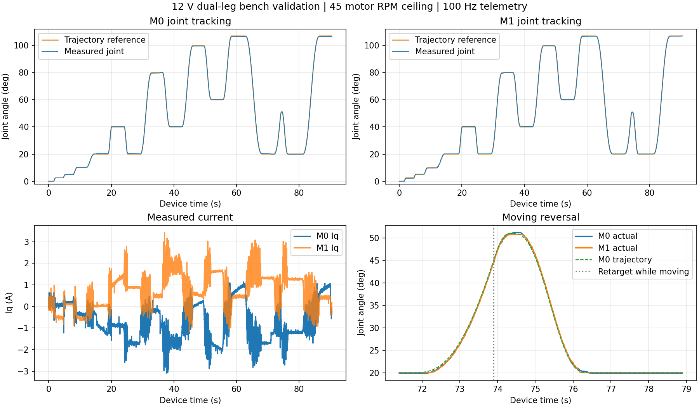

# 五连杆定点控制修复与实测（2026-10-15）

已烧录并通过双路同步路径分级、107°↔20°全跨度反向、运动中更新反向目标。共15段命令、9014帧遥测；程序未触发ADC/PWM、超速、过流或遥测超时，最终发送stop并确认两路IDLE/输出关闭。用户反馈无明显高频噪声、抖动或撞击。

## 这次修复

- 遥测100Hz，电流环10kHz、外环1kHz、轨迹200Hz。跨采样导致快照作废或USB拒收后，下一主循环立即重试；成功发送后才推进10ms节拍，避免相位重复碰撞造成长时间断流。
- 静止目标使用一段关节空间五次曲线；运动中更新目标先从当前参考的位置、速度、加速度平滑制动，再到新目标。两段都预检成功才提交，拒绝时保留旧目标。这样避免反复延长带初速度曲线的预检。
- 减少重复三角函数、固定配置检查、重复扫描；速度换算在中断开放时完成，只短暂原子提交双路目标。100ms提交时限、500ms主机看门狗、原ADC/PWM截止保护保留。

## 实测条件与结果

12V、车模架起支撑、7:1减速箱、已保存主动杆方向标定。只验证此前确认可行的两轴同步路径；物理窗口0°～110°，本次目标2.5°～107°。小幅档10电机RPM/20mm/s，快速档45电机RPM/150mm/s，电流上限10A，硬过流11A、超速180电机RPM均未提高。

| 项目 | 本轮结果 |
|---|---:|
| 稳定关节最大绝对误差 | 0.463° |
| 稳定关节波动最大标准差 | 0.00851° |
| M0/M1峰值Iq | 3.09 / 3.43 A |
| 稳定足端估算最大误差 | 0.640 mm |
| 规划峰值（修复前/后） | 118 / 49 ms |
| ADC中断峰值 | 90.649 µs（周期100µs） |
| 设备帧最大间隔 | 58.1 ms |
| 主机接收最大间隔 | 63.3 ms |
| 快速20°切换首次进入双轴±1° | 约1.03～1.10 s |
| 107°↔20°首次进入双轴±1° | 约5.08～5.10 s |
| 运动中改回20°首次进入双轴±1° | 约2.23 s |

动作时间按设备采样计数计算，自目标首次回显起算；“首次进入±1°”不是完整稳定时间。每段末尾0.5s的误差与波动另外检查。足端位置和关节角来自电机轴磁编及几何模型，未做外部尺量/视觉标定；0.640mm不代表已证明的实物足端绝对精度。高速任意横向路径或不同关节组合的三维净空尚未验证。

## 使用

打开现有VOFA，连接COM8、JustFloat。上电后支撑两路到可靠上止点并点击回零；原方向标定已经保存，无需重复。选择足端模式和快速档，输入x/y毫米目标，点击“移动到目标”；运动中修改坐标再点击“更新目标”。到达后自动持续保持。停止输出会释放重力负载，须支撑机构。同次通电、采样及圈数有效时，可从合法当前位置继续，不必每次回零。

本轮结束未重启，圈数跟踪仍有效，最终目标107°附近已关闭输出。若停机后被动移动到软件窗口外，手动恢复合法且支撑的姿态再启动；不要在任意位置强制归零。冷启动仍需要可靠止点回零。

## 可复核证据

- [结构化实测报告](data/fivebar-motion-validation-20261015.json)
- 原始JSON/CSV：`build/dual-leg/wheel-leg-ui/point-probe-20261015-brake.*`
- 时序和规划RAM：`build/dual-leg/wheel-leg-ui/20261015-final-stage.bin`、`20261015-final-timing.bin`
- 烧录校验成功；ELF SHA256：`30ff8e28f04e3116c2ce7a14341112da28984d668db4393dca9e16f45fc5d537`
- 两路电角度及几何记录（+4096至+4239字节）前后及重复读取逐字节一致。整段备份的旧版前缀两处字不同，偏移1808/3188，保留原始备份供核对；不声称整个扇区逐字节相同。
- 固件构建、45个C配置和7个Python套件、VOFA离屏集成/渲染验证。新增回归覆盖失败遥测重试、100Hz节拍、多个运动阶段的连续反向。

完整操作见[轮腿快速使用](wheel-leg-quickstart.md)，解算方案见[五连杆控制说明](fivebar-foot-control.md)。
