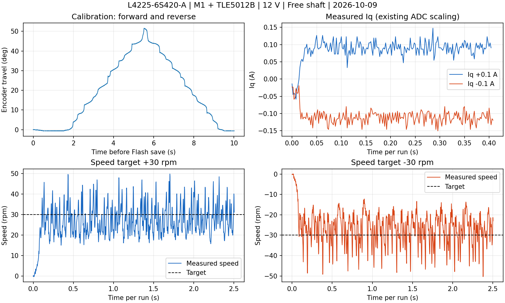

# 龙邱 L4225-6S420-A 空载实测：2026-10-09

已完成 M1 / 原 TLE5012B / 12 V 固件烧录、校准保存和双向空载短测。用户确认磁铁装在新电机轴上、轴自由转动。软件复位后复用校准记录直接进入 RUN；未做实际断电重上电测试。测试结束状态为待机 0、PWM 关闭、fault=0，保留总览组 6 供 VOFA 使用。

## 固件与修复

- 默认组合 `M1/TLE5012B/L4225_6S420_A/FREE_SHAFT/installation=2/WARN`，7 极对，磁编仍 SPI3/PA0。
- M1/TLE5012B 电流环改 10 kHz。原 20 kHz 下 SPI/控制运算挤占 PWM 提交窗口，发生 `0x4101` 时序诊断且 PWM 不开；10 kHz 后实际 PWM 工作。最终复位前读取时序诊断为 0，最小提交计数 4167，最大控制工作 6309 CPU 周期（168 MHz 下约 37.6 µs），周期范围 16788–16812 周期。旧 M1/MT6835 保持 20 kHz。
- 校准 3 A / 1.5 V / 起始电角 15°。较小激励不能完成跟随或回位，因此采用空载短时校准参数；没有放宽原行程和回位判据。零点计算扣除 15°，旧电机校准身份被拒绝。
- 运行 d/q 电压矢量限母线的 10%，速度/位置外环及积分限 ±2 A；WARN 也执行。电流 PI 0.20/80，速度 PI 0.08/0.02。
- 保存 Flash 时已关闭 PWM，采样暂停后首个角度差不再按单采样间隔算速度或误报 SENSOR；后续样本继续原诊断。最后重复校准后告警为 0。

ST-Link 下载并校验成功，软件复位。最终 ELF SHA-256：`e239af9b54d45217a6b00220da8a931c9cdbac334d941e9fc55653ae74247a12`。二进制位于 `build/longqiu/Debug/`；本次数据在忽略的 `build/longqiu/bench-20261009/`，汇总另存[JSON](data/longqiu-bring-up-20261009.json)。

## 校准和测量

最后一次校准编码器相对行程 −0.648° 至 +51.603°，保存后最终相对角度约 +0.011°。B/C 相采样峰值约 3.467/3.354 A；这是现有 ADC 换算值，未用外部仪表验收。校准期间只有保存 Flash 后一次时间戳不连续，序号连续、missing=0；运行短测序号及 200 µs 遥测间隔连续。

sector 11 / `0x080E0000` 最终记录：

```text
00000003 13120007 402B7202 00000001 E4036488 464F4331
```

版本 3，身份 `0x1312`，7 极对，方向 +1，电角零点 2.678833485 rad；FNV 校验正确。软件复位后用这条记录完成下述双向速度短测。

| 工况 | 末段实际均值 | 其他测量 |
|---|---:|---|
| Iq +0.10 A，0.4 s | +0.099978 A | Id 均值 −0.000044 A，电压未饱和 |
| Iq −0.10 A，0.4 s | −0.099943 A | Id 均值 +0.000152 A，电压未饱和 |
| rpm +30，2.5 s | 28.289 rpm | 标准差 6.636，峰值 50.821，行程 403.813° |
| rpm −30，2.5 s | -28.052 rpm | 标准差 7.074，峰值 50.549，行程 -401.199° |

Iq 均值取最后约 0.2 s，速度均值/标准差取最后约 0.5 s；峰值为整段 RUN 的最大绝对值。正/负速度测试 Iq 目标峰值 1.641/1.551 A，实测峰值 1.464/1.643 A。因目标超过 1 A 诊断阈值，速度段记录 CURRENT=1024，WARN 下继续运行；无 fault、拒绝命令或运动遥测丢帧。每段 stop 后均确认 PWM=0。



## 结论与范围

可完成校准、小电流闭环与双向低速旋转；30 rpm 目标有约 2 rpm 均值误差和明显波动，10 rpm 更易出现停走，不作为平滑调速验收。位置模式、带载、长期温升、额定电流/转矩尚未实测。ADC 换算仍使用原 VDDA=3.30 V，ST-Link 读取约 3.12 V；电流绝对精度尚需外部校验。图片 13.5 A 没有用于本次目标，也不证明连续可用转矩。

主机 WARN/TRIP 测试覆盖正反校准、失败扫描拒绝、身份、15° 零点扣除、电压饱和、外环限幅、Flash 恢复和 stop；旧 M0 组合回归通过。真实硬件结果限于上述空载短时工况。

最终主动发送 stop，确认待机/PWM 关闭后清除告警；清除前速度告警保存在汇总中。WARN 下关闭串口或拔 USB 不会自动停机，使用后仍应发送 stop。后续操作见[电机说明](longqiu-first-test.md)。
