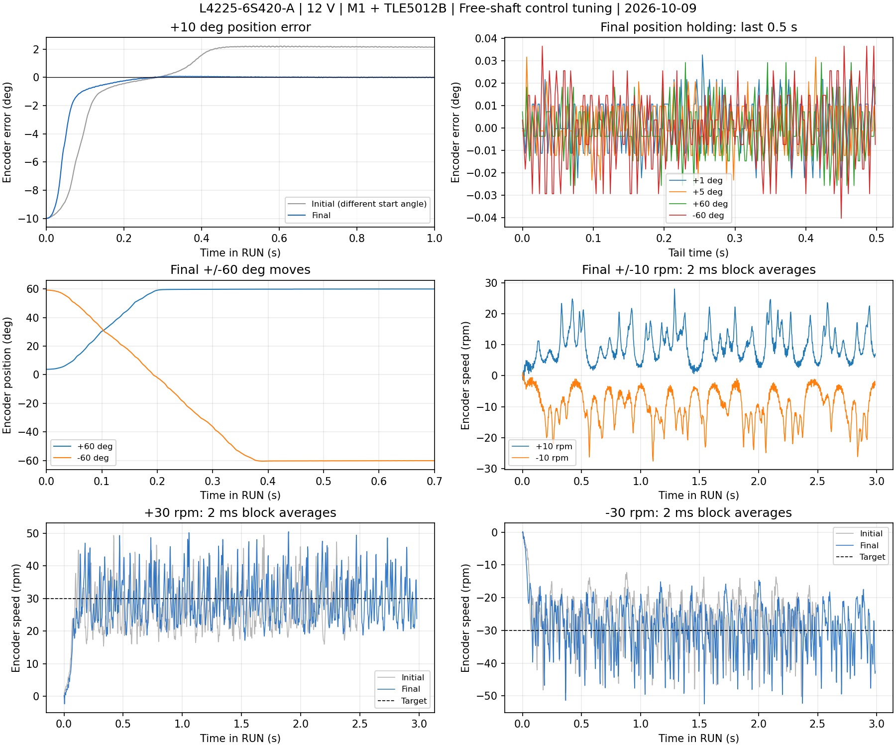

# 龙邱速度环与位置环调试：2026-10-09

最终参数已构建、ST-Link 烧录并校验。在 12 V 空载、M1 / 原 TLE5012B / 安装 2 下，改善了平均速度跟踪和定位；低速纹波仍明显。本次记录接续[首次烧录实测](longqiu-bring-up-2026-10-09.md)。磁编与 SPI 接线保持，已保存的电角校准未更改。

## 最终参数及选择依据

| 参数 | 初始 | 最终 |
|---|---:|---:|
| 电流 PI Kp / Ki | 0.20 / 80 | 0.20 / 80 |
| 速度 PI Kp / Ki | 0.08 / 0.02 | 0.08 / 0.40 |
| 外环测速滤波时间 | 1 ms | 0.5 ms，仅新电机 |
| 位置模式速度 P | 0.08 | 0.06 |
| 位置 P | 4 rpm/° | 12 rpm/° |
| 位置加速 / 刹车 | 300 / 240 rpm/s | 1200 / 960 rpm/s |
| 位置逼近速度上限 | 60 rpm | 60 rpm |
| 速度目标变化率 | 300 rpm/s | 300 rpm/s |

运行电压矢量保持母线的 10%，速度/位置外环及积分仍限 ±2 A。WARN 的 1 A 诊断阈值保留；超过阈值会记录 CURRENT，但不跳闸。直接 Iq 命令仍沿用原 WARN 行为。

增加速度积分消除低速均值误差，降低测速反馈延迟；位置 P 和轨迹反应速度提高，位置模式速度 P 适度降低。初始参数在部分角度出现约 1.8° 残差；过慢轨迹加上较弱位置刚度，在某些角度也会出现数度往复停走。最终配置在这些起始角度及小步进/较大行程上进行了复查。

试验过更高速度比例及电流积分；它们在部分角度产生低速往复振荡，已撤回，没有写入最终配置。未通过增加功率上限来获得本次结果。其他电机配置保留 1 ms 测速滤波和原增益。

## 速度结果

每个目标空载运行 3 s，均值和标准差取最后 0.5 s，峰值为整个 RUN 的最大绝对速度。另从位置采样计算 20 ms 速度标准差，避免只改变测速滤波就判为实际纹波改善。

| 目标 rpm | 末段实际均值 rpm | 外环测速标准差 rpm | 位置推导 20 ms 标准差 rpm | 整段峰值 rpm |
|---:|---:|---:|---:|---:|
| +10 | +9.964 | 4.942 | 4.347 | 28.751 |
| -10 | -9.947 | 5.878 | 5.252 | 27.914 |
| +30 | +29.687 | 6.567 | 3.468 | 51.397 |
| -30 | -29.891 | 7.199 | 4.290 | 53.252 |
| +60 | +59.835 | 9.743 | 2.792 | 87.724 |
| -60 | -59.547 | 10.558 | 3.246 | 94.905 |

初次 ±30 rpm 的均值为 +28.289/−28.052 rpm，本次为 +29.687/−29.892 rpm，均值误差显著缩小。±10 rpm 现在约 +9.964/−9.947 rpm，可完成双向持续旋转。但 10 rpm 的末段标准差仍约 5–6 rpm；30 rpm 纹波也没有显著消除。60 rpm 的高频测速波动与 20 ms 位置推导波动不同，不能把某个滤波后的数字当作外部测速结果。

## 位置结果

测试前在待机设 zero，各目标均在末段持续保持；每段结束发送 stop。下表为磁编反馈误差，**不是外部仪表测得的绝对角度精度**。稳定时间指进入 ±0.5° 后一直保持到结束，至少持续 0.25 s。原点和开始角度随测试改变，前后对比不是严格同角度 A/B 测试。

| 位置目标 ° | 最终反馈误差 ° | 末段保持峰峰值 ° | ±0.5° 稳定时间 s | 最大超调 ° |
|---:|---:|---:|---:|---:|
| +10 | -0.0024 | 0.0439 | 0.151 | 0.074 |
| -10 | -0.0195 | 0.0659 | 0.072 | 0.031 |
| +30 | +0.0256 | 0.0549 | 0.146 | 0.125 |
| -30 | +0.0073 | 0.0659 | 0.230 | 0.037 |
| +0 | -0.0110 | 0.0549 | 0.122 | 0.033 |
| +1 | -0.0222 | 0.0659 | 0.102 | 0.044 |
| -1 | -0.0217 | 0.0659 | 0.044 | 0.044 |
| +5 | -0.0012 | 0.0549 | 0.128 | 0.032 |
| -5 | -0.0208 | 0.0769 | 0.103 | 0.043 |
| +60 | +0.0073 | 0.0659 | 0.210 | 0.029 |
| -60 | -0.0293 | 0.0769 | 0.391 | 0.502 |
| +0 | -0.0110 | 0.0659 | 0.209 | 0.077 |

上述 12 个目标中，最大末值误差 0.0293°，最大保持峰峰值 0.0769°，最大超调 0.502°，最慢进入 ±0.5° 并持续保持约 0.391 s。包含 ±60° 之间的约 120° 反向移动；轨迹目标上限 60 rpm 并非实际瞬时速度硬限，位置测试实际峰值约 92 rpm。stop 解除保持，自由轴会回到自身静止位置。

## 验证与结束状态

- 最终 ELF SHA-256：`c5898763890e935147d79715491d5e2d55f8e047fd3da07edd6b74ae403ab080`，输出 `build/longqiu/Debug/STM32F405-FOC.elf`。
- 主机回归：新电机 WARN/TRIP（校准、记录、限幅、恢复采样、stop）、新电机测速观察器/时间戳回绕/模式切换、旧 M0 USB 和三模式回归均通过。
- 最终速度和位置运动遥测无 fault、拒绝目标或丢帧；目标峰值不超过 ±2 A，速度短测实测 Iq 峰值约 1.77 A。部分工况保留 CURRENT=1024 告警，这是原 1 A 诊断阈值，不是故障。
- SWD 读到 timing、ADC 和编码器错误计数均为 0。PWM 最小提交计数 4091，最大控制工作 6383 周期，采样周期 16788–16812 周期。Flash 校准记录仍为 `00000003 13120007 402B7202 00000001 E4036488 464F4331`。
- 结束主动 stop，确认待机 0 / PWM=0 / fault=0，再 clear，并把当前位置设为位置原点 zero；电角校准不变。保留 send 6，COM8 已关闭，供 VOFA 使用。WARN 下拔 USB 不会自动停机，使用后发送 stop。

原始数据与每组参数/ELF 保存在忽略的 `build/longqiu/tune-20261009/`，可核查汇总另存[JSON](data/longqiu-control-tuning-20261009.json)。工具 `longqiu_tune.py` 可以重复短测，记录真实角度推导速度、定位超调和保持。

结果限于本次空载短时工况；没有带载、长期温升、外部电流或外部角度基准验证。低速纹波和安装角度相关性仍需继续排查，磁编与磁铁的间距及相对定子位置尚未补充。
