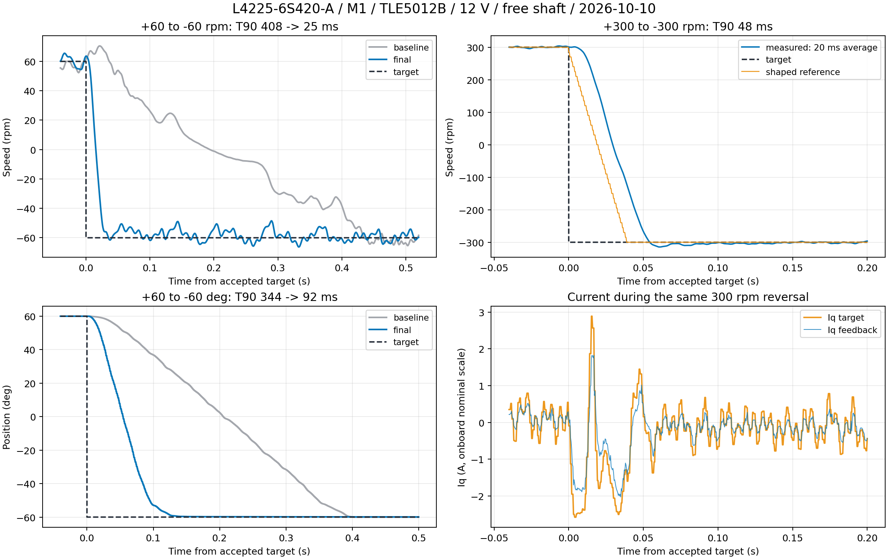

# 龙邱 M1：动态响应调试（2026-10-10）

已完成构建、ST-Link 烧录校验及连续运行中换速、反向、定位复测。用户确认条件为 **12 V、空载自由轴、接线未变**：L4225-6S420-A、M1、TLE5012B / SPI3 / PA0、安装 2。当前使用 final / trial-f 参数，测试结束发送 `stop`，最终复位后也核验待机与 PWM 关闭。

## 对比结果

前后都连续换目标，不在反向前停机；速度测试每目标 1.2 s，位置测试每目标 1 s。基线是本次修改前保存的 10 月 9 日固件；位置基线专门烧回旧固件重测，再恢复最终固件。

| 工况 | 原固件 T90 | 最终固件 T90 |
|---|---:|---:|
| +60 → −60 rpm，两次反向 | 408 / 360 ms | 24.8 / 24.8 ms |
| 10 → 60 rpm | 170 ms | 19.2 ms |
| 60 → 300 rpm | 未测 | 27.2 ms |
| +300 → −300 rpm，两次反向 | 未测 | 47.6 / 47.6 ms |
| +60° → −60°，连续 120° 定位 | 343.6 ms | 92.0 ms |

T90 是从固件首次接受新目标到完成初始值至目标变化量的 90%，**不是稳定时间**。计时来自设备微秒时间戳；速度采用前后相同的 20 ms 尾随平均，位置用板上角度反馈。原始位置差分所得的独立 20 ms 速度也纳入数据，避免只改变测速滤波就认定响应或纹波改善。严格到位另要求误差带内连续 100 ms：速度 ±max(3 rpm, 目标的 5%)、位置 ±0.5°。

最终 ±300 rpm 两次反向的速度到位时间为 52.4 / 62.0 ms；末段平均 −300.03 / −300.01 rpm，20 ms 速度标准差约 1.64–1.73 rpm。±60 rpm 末段均值约 +59.89～59.99 / −60.30～−60.10 rpm，标准差约 2.71–3.26 rpm；部分段未满足严格 ±3 rpm 连续 100 ms 的到位要求，低速纹波仍存在。+60° → −60° 的位置到位时间从 393.6 ms 减至 136.8 ms。

最终 `[10°, −10°, 60°, −60°, 0°]` 连续定位最大超调约 0.031°，末段反馈平均误差在 0.025° 内。这是磁编反馈值，没有外部角度基准。另测 `[1°, −1°, 5°, −5°, 0°]`：±1° 的 T90 仍约 446 / 530 ms，末段最大平均误差约 0.053°，小角度末段接近目标仍慢；10 rpm 首段也存在阻力和纹波，不能将大步进结果推广到所有低速工况。



## 当前参数与实现

仅调整龙邱档案及其可选速度增益调度，旧型号未开启调度。参考速度绝对值 ≤60 rpm 使用低速档，≥150 rpm 使用高速档，中间线性插值；依据经过斜坡整形的参考速度，避免测量噪声切换增益，保留积分状态。

| 参数 | 修改前 | 当前 |
|---|---:|---:|
| 速度/位置外环 Iq 输出与积分上限 | ±2 A | ±6 A |
| 运行 d/q 电压矢量幅值上限 | 母线 10% | 母线 35%（12 V 时 4.2 V） |
| 速度参考斜坡 | 300 rpm/s | 15000 rpm/s |
| 速度 PI / 滤波 | 0.08 / 0.40 / 0.5 ms | 低速相同；高速 0.04 / 0.80 / 2 ms |
| 位置模式速度 P | 0.06 | 低速 0.06、高速 0.04 |
| 位置 P | 12 | 12 |
| 定位速度上限 | 60 rpm | 240 rpm |
| 定位加速度 / 刹车减速度 | 1200 / 960 rpm/s | 10000 / 4800 rpm/s |
| 电流诊断 / 相电流诊断阈值 | 1 / 4 A | 5 / 10 A |
| 速度模式诊断阈值 | 200 rpm | 600 rpm |

电流 PI 保持 0.20 / 80 s⁻¹，抗饱和 1200 s⁻¹；电流环 10 kHz、外环 1 kHz。校准 3 A / 1.5 V / 15°、极对数、安装编号及磁编接口未变。R/L/磁链未知，前馈关闭。电压上限、外环 ±6 A 在 WARN 下也执行；5 A、10 A 是 WARN 诊断阈值，**不是 WARN 自动关断值**。直接 Iq 命令仍沿用原策略。

调参过程中，提高电流和电压后仍使用高速度 P 的方案出现明显纹波，已撤回；全速域采用低 P 的方案减弱低速阻尼，也已撤回。更快的定位刹车曾出现约 1.55° 超调，最终采用上述加速度/刹车组合。

最终速度及定位数据：Iq 目标峰值约 3.63 A，反馈 Iq 峰值约 2.63 A，母线约 11.91–12.12 V；故障、累计告警、拒绝命令和序号间断均为 0。6 A 是留出的控制余量，本次没有验证连续 6 A、带载、长期温升或额定功率，板上电流仍是未经外部标定的标称比例。

## 复现与证据

汇总数据和各段完整指标见 [JSON](data/longqiu-dynamic-response-20261010.json)。本机完整 24 通道原始 `.npy`、各次参数、基线固件与阶段统计保留在忽略目录 `build/longqiu/dynamic-20261010/`。最终 ELF 的 SHA256、待机读数和 SWD 核验也写入 JSON。主机回归通过龙邱 WARN/TRIP、电压饱和与校准身份、连续反向/计时回绕/方向/模式切换、观察器及旧 M0 组合测试。

连续阶跃工具从 variant 目录运行，运行前断开 VOFA 串口：

```powershell
python tools/bench/longqiu_dynamic.py --out build/dynamic-speed60 --kind speed --targets 10 60 -60 0 60 -60 --dwell 1.2 --max-rpm 180 --max-current 4
python tools/bench/longqiu_dynamic.py --out build/dynamic-speed300 --kind speed --targets 60 300 -300 0 300 -300 --dwell 1.2 --max-rpm 450 --max-current 4
python tools/bench/longqiu_dynamic.py --out build/dynamic-position --kind position --targets 10 -10 60 -60 0 --dwell 1 --max-rpm 350 --max-current 4
```

工具的电流/转速/母线边界只是此次实验的中止条件，退出和独立总时限都会尝试发送 stop，不能替代硬件保护。当前位置会在每次实验前设为软件零点。

[VOFA 单电机配置](vofa-longqiu.md)已同步速度输入 ±300 rpm、速度图 ±400 rpm、电流图 ±8 A，位置输入仍为 ±60°，默认值仍为 10 rpm / 5°，不会自动发送运动目标。结束用 `stop`；WARN 的单次目标持续有效，断开 USB 不会停机。
